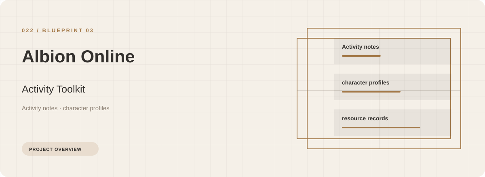
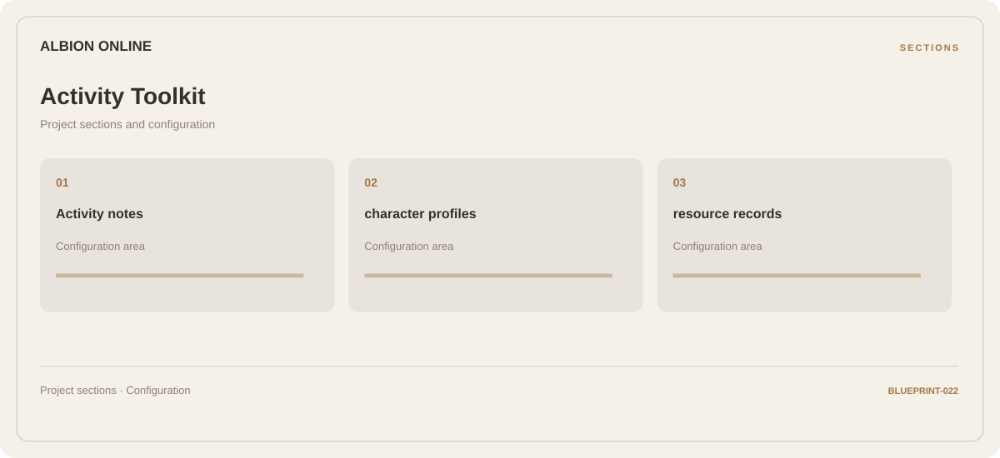

# ⚡ Albion Online Activity Toolkit

**Activity notes · Character profiles · Resource records**

## ⚡ Features

Use the Albion Online activity toolkit workspace to move between activity notes, character profiles, and resource records. The section map below gives each part a clear place in the project.

### ⚙️ Activity notes

Session and activity information grouped by the task or context it belongs to.

### 🧩 Character profiles

Related settings collected into named groups for a clearer configuration workflow.

### ⌨️ Resource records

Inventory and resource categories organized alongside their related values and notes.

## 🖥️ Project navigation

## 📥 Download

The button and cover open the project's download page. Use the information supplied with the downloaded package for installation and release-specific requirements.

## 📚 Project documentation

- [Feature reference](docs/FEATURES.md)
- [Download information](docs/DOWNLOAD.md)
- [Project page](index.html)

---

Albion Online Activity Toolkit · Program documentation and download information.
